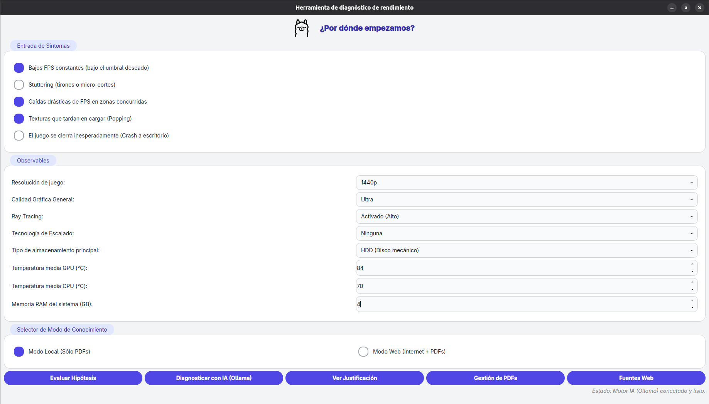

# Gaming PC Performance Diagnostic (Local AI)

Desktop application that helps diagnose performance problems when running video games on a PC (low FPS, stuttering, texture pop-in, crashes). The user selects the symptoms and enters hardware and graphics settings, and a large language model running **locally through Ollama** analyses the data and returns a diagnosis with an explanation. Nothing is sent to external services.

Built with **Python** and **PyQt6** as a university project for the Computer Engineering degree at the University of Córdoba.



## Features

- **Symptom and hardware input:** low FPS, stuttering, crashes, resolution, graphics quality, ray tracing, upscaling (DLSS/FSR/XeSS), storage type, CPU/GPU temperatures and RAM.
- **AI diagnosis with a local LLM:** builds a prompt from the user's data and queries Llama 3 through the Ollama API.
- **Responsive interface:** the AI request runs in a background thread (`QThread`), so the window never freezes while the model is working, and a progress bar shows the status.
- **Configurable domain:** the symptoms and inputs are not hard-coded. The interface is generated dynamically from `config_dominio.json`, so the tool can be adapted to another diagnostic domain without touching the UI code.
- **Detailed explanation window** with the full reasoning returned by the model.

## Architecture

The application follows the **Model-View-Controller** pattern:

- Model: File `mvc/model.py`. Loads the domain configuration, stores the user's input and talks to Ollama.
- View: File `mvc/view.py`. PyQt6 main window and dialogs, generated from the configuration.
- Controller: File `mvc/controller.py`. Connects the UI events to the model and runs the AI request in a background thread.

## Tech stack

Python 3 · PyQt6 · Ollama · Llama 3 · JSON

## Getting started

1. Install [Ollama](https://ollama.com/) and download the model:
   ```bash
   ollama pull llama3
   ```
2. Install the Python dependencies:
   ```bash
   pip install PyQt6 ollama
   ```
3. Make sure the Ollama server is running, then start the app from the project folder:
   ```bash
   python main.py
   ```
